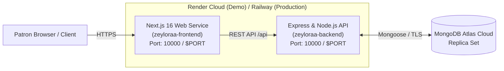

# Zeyloraa Deployment Guide: Render (Demo) & Future Railway Migration

This guide outlines how to deploy the **Zeyloraa Fine Jewellery** platform for demonstration on **Render** (free tier), with an architecture designed for zero-code-change migration to **Railway** later.

---

## 🏛️ Deployment Architecture



---

## 🚀 Part 1: Deploying to Render (For Demonstration)

Render allows you to deploy both services simultaneously using the pre-configured [render.yaml](render.yaml) Blueprint.

### Option A: 1-Click Render Blueprint (Recommended)

1. **Sign In to Render**: Go to [dashboard.render.com](https://dashboard.render.com) and log in with your GitHub account.
2. **Create New Blueprint**:
   - Click the **"New +"** button at the top right.
   - Select **"Blueprint"**.
   - Connect your GitHub repository: `Jewellery_E--Commerce_Website`.
   - Render will automatically detect and parse the root [render.yaml](render.yaml).
3. **Configure Environment Variables**:
   Render will prompt you for the required environment variables:
   - **`MONGODB_URI`** (for `zeyloraa-backend`):
     Paste your MongoDB Atlas connection string:
     ```
     mongodb+srv://<username>:<password>@cluster.mongodb.net/jewellery_store?retryWrites=true&w=majority
     ```
   - **`NEXT_PUBLIC_API_URL`** (for `zeyloraa-frontend`):
     Enter your backend URL with `/api`:
     ```
     https://zeyloraa-backend.onrender.com/api
     ```
     *(Note: If your backend service has a slightly different name on Render, use `https://<your-backend-name>.onrender.com/api`)*
4. **Click "Apply"**:
   Render will automatically build and launch both services!

---

### Option B: Manual Service Setup on Render

If you prefer to configure each service manually in the Render web dashboard:

#### 1. Backend Service (`zeyloraa-backend`)
* **Type**: Web Service
* **Name**: `zeyloraa-backend`
* **Root Directory**: `backend`
* **Environment**: `Node`
* **Region**: `Oregon (US West)` or `Singapore`
* **Branch**: `main` (or your active branch)
* **Build Command**:
  ```bash
  npm install --include=dev && npm run build
  ```
* **Start Command**:
  ```bash
  npm run start
  ```
* **Health Check Path**: `/api/health`
* **Environment Variables**:
  | Key | Value |
  | :--- | :--- |
  | `NODE_ENV` | `production` |
  | `PORT` | `10000` |
  | `MONGODB_URI` | *(Your MongoDB Atlas connection string)* |
  | `JWT_SECRET` | *(Generate a random 32+ character key or click Generate)* |
  | `JWT_EXPIRES_IN` | `7d` |
  | `FOUNDER_EMAIL` | `concierge@zeyloraa.com` |
  | `CLIENT_URL` | `*` |

#### 2. Frontend Service (`zeyloraa-frontend`)
* **Type**: Web Service
* **Name**: `zeyloraa-frontend`
* **Root Directory**: `frontend`
* **Environment**: `Node`
* **Branch**: `main`
* **Build Command**:
  ```bash
  npm install --include=dev && npm run build
  ```
* **Start Command**:
  ```bash
  npm run start
  ```
* **Environment Variables**:
  | Key | Value |
  | :--- | :--- |
  | `NODE_ENV` | `production` |
  | `NEXT_PUBLIC_API_URL` | `https://zeyloraa-backend.onrender.com/api` |
  | `NEXT_PUBLIC_GOOGLE_CLIENT_ID` | `982958918078-b9pfa8pev88vgfs9pi312a00lvajjjb5.apps.googleusercontent.com` |

---

## 💡 Important Tips for Render Demonstration

1. **Free Tier Cold Starts (Spin-down)**:
   * Render's free tier web services spin down after 15 minutes of inactivity.
   * **Before starting your demonstration**: Open your backend health URL in your browser (`https://zeyloraa-backend.onrender.com/api/health`) 1–2 minutes beforehand. This wakes up the container so your demo loads instantly.
2. **MongoDB Atlas IP Access**:
   * In your [cloud.mongodb.com](https://cloud.mongodb.com) Atlas dashboard, ensure your Network Access has `0.0.0.0/0` (Allow access from anywhere) enabled so Render's dynamic IP addresses can connect to your database.
3. **One-Time Super Admin Seeding**:
   * Once your backend is deployed, you can seed the Super Admin account from the Render Shell tab by running:
     ```bash
     npm run seed:admin
     ```

---

## 🚂 Part 2: Future Migration to Railway

When you are ready to switch from Render to **Railway**, the codebase is 100% pre-configured. No code changes are required!

### Switching to Railway in 3 Steps:

1. **Open Railway**: Go to [railway.app](https://railway.app) and click **"New Project"** -> **"Deploy from GitHub repo"**.
2. **Add Backend Service**:
   - In Settings, set **Root Directory** to `backend`.
   - Railway will auto-detect Node.js via [railway.json](railway.json).
   - Add your environment variables (`MONGODB_URI`, `JWT_SECRET`, `NODE_ENV=production`).
   - Railway will provide a public domain (e.g. `https://zeyloraa-backend.up.railway.app`).
3. **Add Frontend Service**:
   - In the same project, click **"+ New"** -> **"GitHub Repo"** -> select the same repository.
   - In Settings, set **Root Directory** to `frontend`.
   - Add `NEXT_PUBLIC_API_URL` pointing to your Railway backend URL + `/api` (e.g. `https://zeyloraa-backend.up.railway.app/api`).
   - Deploy!

Railway does not spin down containers on free/starter tiers, making it great for production.

