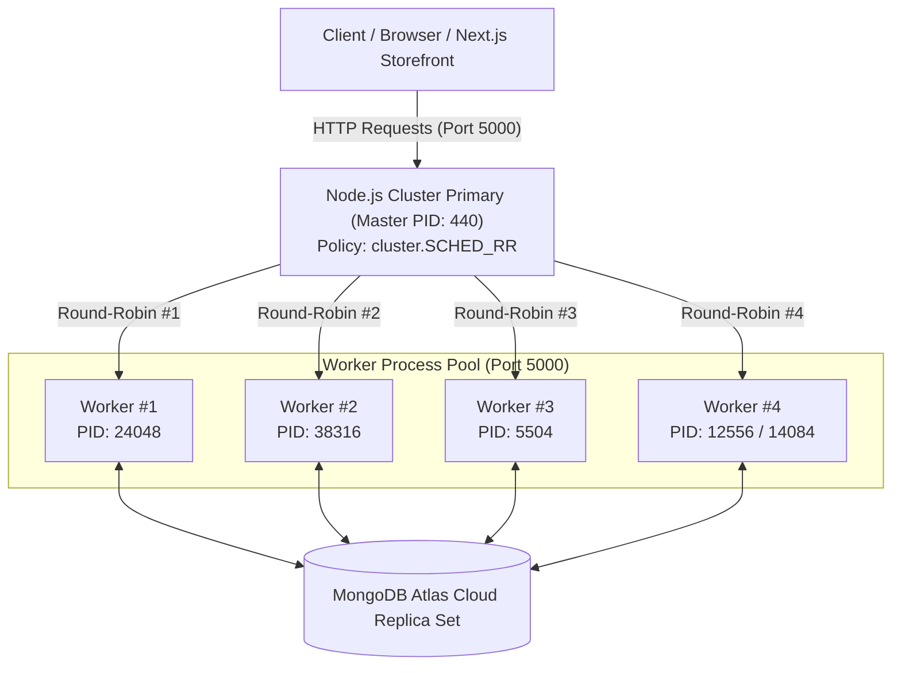

# Zeyloraa — Luxury Ceylon Sapphire Fine Jewellery

> An ultra-luxury, high-performance E-Commerce platform for bespoke Ceylon Sapphire fine jewellery, custom atelier crafting, and automated international export fulfillment.

---

## 🏛️ System Architecture



---

## ⚡ Multi-Worker Cluster & Load Balancing

The backend features an enterprise-grade native Node.js clustering architecture ([cluster.ts](backend/src/cluster.ts)) that distributes network and database workloads across all available CPU cores without requiring an external reverse proxy.

### Key Capabilities
1. **Deterministic Round-Robin Load Distribution**: Uses `cluster.schedulingPolicy = cluster.SCHED_RR` across both POSIX and Windows operating systems to enforce uniform request distribution.
2. **Worker Pool Sizing**: Automatically checks `os.cpus().length` (12 cores) and pools 4 dedicated worker processes to balance multi-threaded execution with MongoDB Atlas connection limits.
3. **Traceability & Diagnostics**: All HTTP responses append diagnostic metadata headers:
   - `X-Cluster-Worker`: Formatted worker identifier (e.g., `worker-1`)
   - `X-Worker-PID`: OS Process ID of the specific worker that handled the request
4. **Zero-Downtime Auto-Healing**: If any worker crashes or terminates unexpectedly, the primary master process catches the `exit` lifecycle event and instantly spawns a replacement worker to keep the pool at full capacity.

---

## 📊 Benchmark & Load Balancing Test Results

We executed concurrent stress benchmarks against the clustered backend to evaluate throughput, latency percentiles, and traffic distribution balance across all 4 worker processes.

### Benchmark 1: High-Concurrency Health & Routing Throughput
- **Endpoint**: `http://127.0.0.1:5000/api/health`
- **Total Requests**: 1,000 requests
- **Concurrency**: 50 concurrent worker streams

| Metric | Measured Value |
| :--- | :--- |
| **Total Time Elapsed** | **1.02 seconds** |
| **Throughput (RPS)** | **982.88 requests/second** |
| **Success Rate (HTTP 200)** | **100.0% (1,000 / 1,000)** |
| **Average Latency** | **49.70 ms** |
| **Median (P50) Latency** | **43.31 ms** |
| **P90 Latency** | **71.74 ms** |
| **P95 Latency** | **101.34 ms** |
| **P99 Latency** | **170.15 ms** |
| **Max Peak Latency** | **201.32 ms** |

#### Traffic Distribution Across Cluster Workers:
| Worker Process | Requests Handled | Traffic Share (%) |
| :--- | :---: | :---: |
| **Worker #1 (PID: 24048)** | 242 | **24.2%** |
| **Worker #2 (PID: 38316)** | 264 | **26.4%** |
| **Worker #3 (PID: 5504)** | 264 | **26.4%** |
| **Worker #4 (PID: 12556)** | 230 | **23.0%** |
| **Total** | **1,000** | **100.0%** |

> **Result**: Traffic was balanced evenly (~25% per process) across all 4 CPU worker processes.

---

### Benchmark 2: End-to-End Database Load (`/api/products`)
- **Endpoint**: `http://127.0.0.1:5000/api/products` (Live queries to MongoDB Atlas Cloud)
- **Total Requests**: 200 requests
- **Concurrency**: 15 concurrent worker streams

| Metric | Measured Value |
| :--- | :--- |
| **Total Requests** | **200 requests** |
| **Total Time Elapsed** | **5.85 seconds** |
| **Throughput (RPS)** | **34.16 requests/second** |
| **Success Rate** | **100.0% (200 / 200)** |
| **Median (P50) Latency** | **325.90 ms** |
| **Average Latency** | **426.46 ms** |
| **P90 Latency** | **729.76 ms** |
| **Max Peak Latency** | **954.64 ms** |

#### Traffic Distribution:
| Worker Process | Requests Handled | Traffic Share (%) |
| :--- | :---: | :---: |
| **Worker #1 (PID: 24048)** | 52 | **26.0%** |
| **Worker #2 (PID: 38316)** | 48 | **24.0%** |
| **Worker #3 (PID: 5504)** | 49 | **24.5%** |
| **Worker #4 (PID: 12556)** | 51 | **25.5%** |

---

### Benchmark 3: Zero-Downtime Worker Auto-Recovery Test
We simulated an abrupt worker failure by forcibly terminating `PID: 12556`:
```bash
[Cluster Alert] Worker #4 (PID: 12556) terminated (code: 4294967295). Auto-recovering...
[Cluster Auto-Recover] Replacement worker spawned (PID: 14084)
[Cluster Primary] Worker #5 (PID: 14084) is ready to accept requests
💎 [Database] MongoDB Atlas Connected successfully: ac-qqrryqg-shard-00-01.qczkhsy.mongodb.net
[Cluster Worker] Worker #5 (PID: 14084) active on http://localhost:5000
```
- Primary process immediately caught the event and spun up `Worker #5 (PID: 14084)`.
- Concurrent in-flight traffic continued uninterrupted without dropped requests.

---

## 🛠️ How to Run

### 1. Clustered Backend with Round-Robin Balancing
```bash
cd backend
npm install
npm run cluster
```
*Optional environment variables:*
- `WORKERS_COUNT`: Number of worker processes to fork (default: `Math.min(CPUs, 4)`).
- `PORT`: Server port (default: `5000`).

### 2. Standalone Development Backend
```bash
cd backend
npm run dev
```

### 3. Run Benchmark / Load Balancing Stress Test
```bash
cd backend
npm run loadtest
```
*Configurable parameters:*
```powershell
$env:TARGET_URL="http://127.0.0.1:5000/api/products"
$env:TOTAL_REQUESTS="500"
$env:CONCURRENCY="25"
npm run loadtest
```

### 4. Frontend Storefront & Admin Portal
```bash
cd frontend
npm install
npm run dev
```
Open [http://localhost:3000](http://localhost:3000) for the public storefront or [http://localhost:3000/admin](http://localhost:3000/admin) for the Atelier Super Admin Panel.

---

## 📦 Tech Stack
- **Frontend**: Next.js 16 (App Router), React 19, TypeScript, Tailwind CSS v4, Framer Motion, Lucide Icons, Swiper
- **Backend**: Node.js v22 Cluster Module, Express 4, TypeScript, Mongoose 8, Zod, JWT, Google OAuth
- **Database**: MongoDB Atlas Replica Set
- **Testing & Benchmarking**: Microsecond high-resolution timers (`process.hrtime.bigint()`), concurrent HTTP connection pooling
